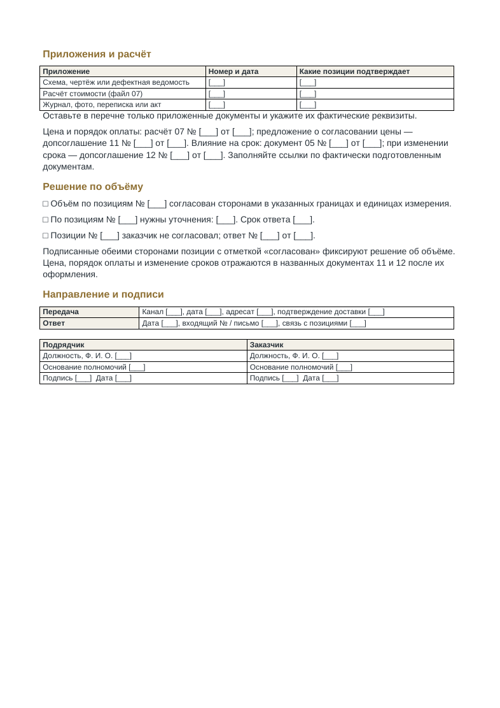
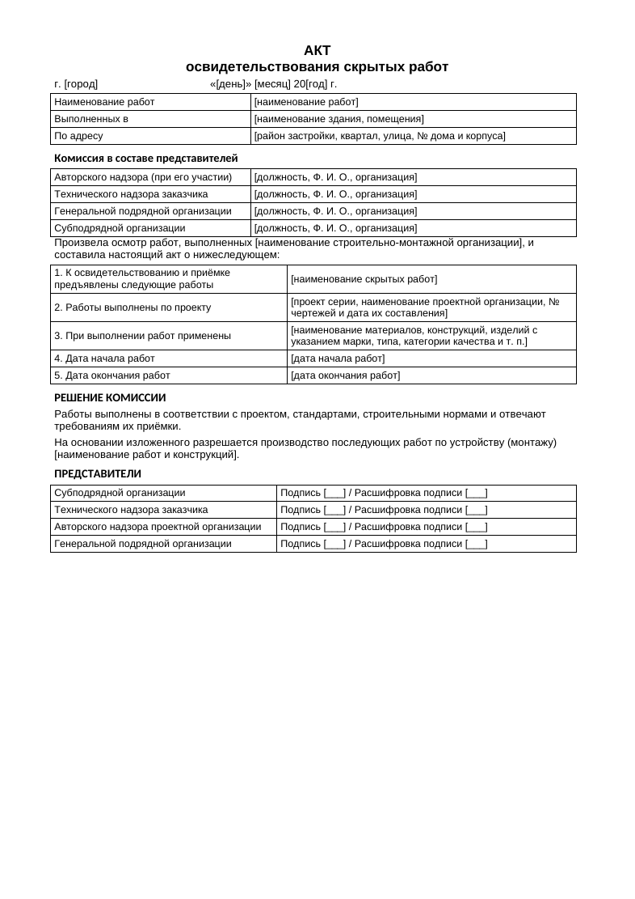

# НСП — P2 v13: пакет после замечаний владельца

**Для проверки владельцем. Не публикация товара.**

[Скачать весь комплект — 13 файлов](P2-NSP-v13-13-files-20261029.zip?raw=true)

[Предпросмотр всех Word-форм — 9 страниц PDF](P2-v13-Word-preview.pdf?raw=true) · [Единая PDF-инструкция — 5 страниц](00-INSTRUKCIYA.pdf?raw=true)

## Что изменено
- В покупательском ZIP только одна инструкция: `00-INSTRUKCIYA.pdf`. Полезные пояснения из TXT, включая печать Excel, включены в неё. Исходник инструкции в DOCX хранится отдельно и в покупательский ZIP не входит.
- Акт №04 заменён редактируемым DOCX на основе предоставленного владельцем `blank-akt-skrytyh-rabot.doc`. Сохранены содержание и четыре роли подписантов; исправлена опечатка «председателей» на «представителей». Скан акта удалён из выдачи. Это не заявление о тождестве новой формы официальному рекомендуемому образцу или о новой юридической экспертизе.
- Во всех восьми Word-формах таблицы одинаковой внешней ширины: 9866 twips (17,4 см). Исправлены сетка, ширины ячеек и автоподбор; колонка номера сужена.
- Передача/ответ и подписи оформлены самостоятельными таблицами с отступом и совпадающими границами. Содержание семи прежних рабочих форм не изменено.
- Excel №07 и №08, PDF №09 и №10 сохранены побайтно. Повторных расчётных тестов, заполненных длинными примерами проверок и циклов повторного открытия не было. Выполнен только контроль изменённой вёрстки.

## Быстрый просмотр исправлений

## Границы выпуска
В этом архиве исправлен P2. [Единое правило для линейки](LINE_LAYOUT_RULE_RU.md) сохранено, но другие комплекты этой операцией не перепаковывались. Предыдущие выпуски сохранены. Сайт, платежи и production не менялись; размещение на GitHub предназначено для просмотра.

[Состав и контрольные суммы](REVIEW_MANIFEST.json)
